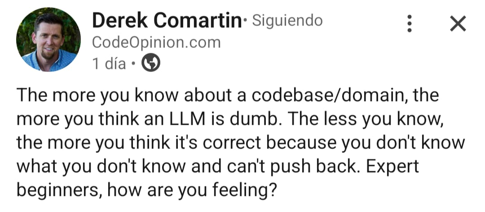

LLMs are good at many things. They are especially good at making a guess look like an answer.

Give one a plausible request and it will produce code, tests, documentation, a confident explanation, and sometimes a tiny victory lap. That fluency is useful. It is also dangerous. **An LLM can make you feel like you understand a system before you have discovered what the system is.**

I have started thinking of them as *Dunning-Kruger factories*: machines that can manufacture the feeling of competence at industrial speed. I mean that as a provocation, not as a psychological diagnosis of a language model. The practical point is simpler: the less you know about a domain, the harder it is to notice what the model has missed, and the more persuasive its answer can feel.

The real danger is not that the machine will write an obviously foolish function. It is that it will write a plausible one, for a plausible interpretation of a problem, inside a system whose most important constraints were never stated.

## We have mistaken cheaper code for cheaper software

We already depend on systems that are difficult to understand and surprisingly easy to disrupt. On November 16, customers reported problems with transactions at Chase and other banks after Chase experienced a technical issue. The [New York Times reported](https://www.nytimes.com/2026/11/16/us/bank-outages-down.html) that Chase's issue could also affect customers at other institutions when Chase was part of a transaction.

I am not suggesting AI caused that outage. It is a reminder of the world software already inhabits: a failure in one part can travel through connections and become someone else's problem. The modern system is rarely one application with one owner. It is a mesh of services, vendors, legacy hardware, policies, people, and assumptions. We depend on it more each year, often without seeing how much depends on how much else.

My concern is that AI is not automatically making those systems less complex or less fragile. In many organizations, it is doing the opposite. It makes another feature, integration, automation, or “quick” internal tool cheap enough to say yes to. But the cost of producing code was never the whole cost of producing software.

**Code can be cheap to create and expensive to own.**

The first version is often the easy part. A convincing demo can appear in an afternoon. A workflow can look real enough to trigger expectations, attract users, and earn a roadmap. Then the real world arrives: permissions, exceptions, migrations, audit trails, data quality, support, outages, users who do not behave like the happy path, and teams that disagree about what the feature was supposed to mean.

A prototype can create the impression that the hard work is over. In production, it is often the moment the hard work begins.

## The expert beginner has a new productivity tool

AI has lowered the barrier between “I have an idea” and “I have something that looks like software.” That is a real gain. It lets more people explore an idea and communicate it concretely. A business expert who can now build a rough prototype may help a team see a workflow that was difficult to describe in a meeting.

But a prototype is not a proof of understanding. It is a hypothesis with a user interface.

Some newly empowered experts, let us call them *visionary platform strategists* when they have booked the conference room, have taken the next step: perhaps the inconvenient engineers, with their expensive salaries and awkward questions, can be removed from the process altogether. Surely the model can turn the requirements into production software. How hard can it be?

That question is usually asked before anyone has had to operate the result.

An LLM can help implement an idea. It cannot make an incomplete idea complete just by making it compile. It cannot infer which business policy is authoritative when three departments disagree. It cannot know that an exception is legally required, that an old integration carries an undocumented commitment, or that a team uses the word “customer” to mean three different things.

It can generate an answer to the question it was given. **It cannot rescue us from the questions we did not know to ask.**

The screenshot below captures an observation by [Derek Comartin](https://codeopinion.com/): the more you know about a codebase or domain, the more readily you spot where an LLM is wrong. That resonates with my experience. Expertise does not make the model less capable; it makes its omissions more visible.

This is why I am skeptical when “it works” means “the demo ran once.” Running is not the same as being correct. Passing a test suite is not the same as satisfying the business. And an answer that sounds expert is not evidence that anyone has checked its assumptions.

## More output moves the bottleneck

The rush to adopt AI is not happening in a vacuum. There is FOMO, genuine excitement, pressure to show investors a return, and a market full of tools whose subsidized prices and capabilities change every few months. Faced with that noise, companies are making big bets on AI and sometimes cutting the people who know how their systems work at the same time.

That can feel like acceleration. More commits, more pull requests, more features in progress. But throughput at one stage is not throughput for the whole system. If code production gets faster while understanding, integration, testing, and review do not, the queue simply moves.

A recent [working paper by Fiona Chen and James Stratton](https://fion.ac/jellyfish.pdf), *Artificial Intelligence in the Firm: Bottlenecks in Software Production*, analyzes 445 million work events across 655 firms. The authors report that AI adoption substantially increases code output, with a smaller effect on completed software output; they also find that code review becomes a bottleneck. In their sample, they detect no employment effect from adoption over the period studied. This is not a universal verdict on every team or tool, and the paper is still a working paper. It is, however, a useful challenge to the simplistic equation of more generated code with more shipped software.

The important question is not “How many lines did the model write?” It is “How much useful, verified change reached users, and what did it cost us to get there?”

If review is already a bottleneck, generating more code does not remove it. It may make the pile taller. If reviewers are asked to approve changes they did not shape, in parts of the system they no longer understand, the problem is not just the number of lines. It is the shrinking ability to tell whether those lines belong there at all.

A tempting response is to automate review too and let agents approve agents. That may help with some mechanical checks. But a machine cannot validate an unstated policy or recognize a hidden organizational promise unless we have given it enough context, and know what context matters. Automating the appearance of review is not the same as taking responsibility for a change.

**The bottleneck is not an inconvenience to eliminate. It is information about where the hard work lives.**

## The hard part was never typing

Software engineering has always involved much more than translating a specification into code. The specification is usually partial, inconsistent, or wrong in ways nobody has discovered yet. The work is to find out what people actually need, what the existing system already promises, which constraints matter, and where a proposed change will collide with something else.

That makes engineers detectives more than requirement clerks. We look for evidence in code, data, support tickets, conversations, operational behavior, and the spaces between teams. Sometimes a person does not know what they need until they hear a different constraint and change their mind halfway through a discussion. That is not a failure of requirements gathering. It is discovery.

Conway's Law describes one reason these problems are stubborn: systems tend to reflect the communication structures of the organizations that build them. If knowledge is split across teams, incentives conflict, and the people who understand a workflow cannot talk to the people building it, no coding assistant will dissolve those boundaries. The [law's implications](https://martinfowler.com/bliki/ConwaysLaw.html) are architectural because they are human first.

AI works with the context it can access and the questions we ask. **Context is still king.** But context is not a magic dump of documents into a prompt. Someone has to discover it, judge what is relevant, resolve contradictions, and keep the resulting understanding coherent as the system changes. That someone needs enough knowledge to know when an answer is missing something.

The better the model gets at writing code, the more valuable it becomes to know whether that code should exist.

## Greenfield is a seductive demo; production is the argument

Starting from an empty repository is seductive. The context is small. There are no existing users to disappoint, no awkward migration, no data that has accumulated fifteen years of edge cases, no adjacent team who depends on a behavior everyone forgot to document. A prompt, a few iterations, and the result can look astonishingly complete.

Then users arrive. The system accumulates state. People build workarounds. Another service depends on its behavior. A business rule changes. A “temporary” exception becomes a contract. The original authors move on. What looked like a small application becomes part of a larger machine.

**The demo shows that software can be started quickly. Production shows whether it can be changed safely.**

That is why the ability to remove and replace code matters as much as the ability to produce it. In [“The Art of Destroying Software,” Greg Young argues for designing software so parts can be deleted and rewritten without fear](https://www.youtube.com/watch?v=1FPsJ-if2RU). The useful idea is not to destroy things for sport. It is to make change survivable: keep boundaries clear, limit the size of components, and avoid letting a decision become permanent merely because it is expensive to undo.

AI increases the need for that discipline. If generation is cheap, we will generate more experiments, more alternatives, and more code that may later prove unnecessary. We should optimize not only for writing a feature, but for learning that we no longer need it, and removing it cleanly.

A system that is easy to change is valuable. A system that is easy to delete is freer still.

## Agile was supposed to learn as it went

Waterfall's weakness was not that planning or design are useless. It was the assumption that we could settle too much up front, at the point when we know the least about the project, then move through rigid phases as if reality would politely hold still.

The [Agile Manifesto](https://agilemanifesto.org/) put individuals and interactions, working software, customer collaboration, and responding to change ahead of process, exhaustive documentation, contract negotiation, and a plan. It did not say “skip analysis.” It described a feedback loop in which understanding grows through building, testing, talking, and revising.

The rituals that later grew around Agile sometimes lost that point. A team can hold every ceremony on the calendar and still avoid learning. The same thing can happen with AI and specification-driven development: produce a large, detailed spec at the start, hand it to an agent, and call the result efficient because the code appeared quickly.

That can become Waterfall with a faster typing phase. The hidden cost moves to the front-loaded assumptions and the back-loaded review.

A specification is useful when it records what we have learned and gives us something concrete to question. It is dangerous when we treat it as a complete map of a domain we have not yet explored. We should be using AI to shorten feedback loops, not to make our first guess arrive in production sooner.

## The knowledge we stop practicing will become scarce

There is another risk in delegating more of the thinking. The path matters, not just the artifact at the end. When engineers work through a problem, reading unfamiliar code, tracing a failure, arguing about a model, testing a hypothesis, they build the mental map that lets them notice when the next change is wrong.

If we hand off every difficult step, we may still get an answer. We may also lose the people who can evaluate it. Verification is not a button that appears automatically once generation gets fast. It is a skill built from fundamentals, experience, and contact with the system.

The same is true of knowledge in the models themselves. Today's systems draw on a vast body of human-created material. We do not yet know how the supply and quality of that material will evolve as more writing and code are generated by models, nor how future systems will handle knowledge that is rare, local, poorly documented, or outside the dominant patterns in their training. But novelty and edge cases are exactly where “the most statistically familiar answer” may be least useful.

This is not a prediction that AI will run out of ideas next year. It is a reason to preserve human expertise, primary sources, and the habit of thinking from fundamentals rather than treating the model's most likely continuation as the answer by default.

## I am not afraid of the tool. I am wary of the story

I am not pessimistic about engineers being replaced by AI. I use these tools and appreciate what they can do. They are amplifiers: they can help a thoughtful engineer explore, explain, prototype, and implement more effectively. They can also help an organization scale its confusion, ship assumptions faster, and create a larger review backlog.

The tool does not decide which direction to amplify. We do.

In the short term, it is understandable that companies will cut costs, buy tools, announce transformations, and try to demonstrate returns. There will be real gains. There will also be expensive experiments, discarded products, and some promises that do not survive contact with production. If investment cools or a bubble deflates, that will not mean the technology disappears. It will mean the market has to distinguish durable value from a particularly elaborate demo.

The skeptics I trust are not the ones who refuse to try AI. They are the ones who use it, see its strengths, and still ask what the new process has made harder to see. Calling every question fear of replacement is a convenient way to avoid answering it.

We need engineers who combine technical judgment with domain knowledge; who can share what they know across teams; who can ask questions that reveal the missing rule; who can distinguish code that works from software that serves a purpose; and who understand that choosing not to build something is also an engineering decision.

Those people will not become less important as code gets easier to produce. **They will become harder to find, and more valuable.**

So yes: use the model. Let it draft, explore, explain, and surprise you. Then read the result. Question its assumptions. Bring it the context it cannot discover on its own. And when it confidently heads in the wrong direction, be willing to say the simplest useful thing an engineer can say:

**Yes, you're wrong.**

