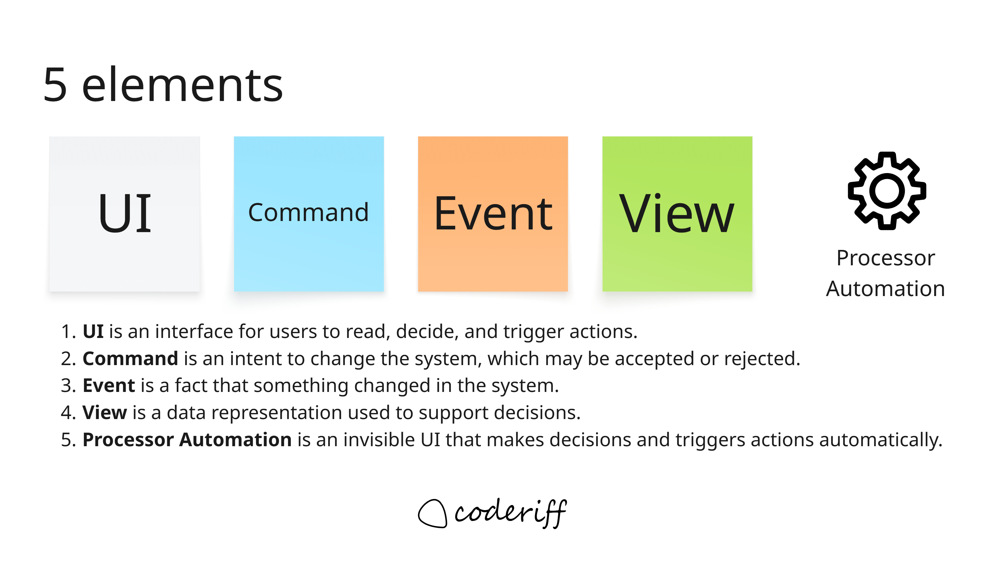
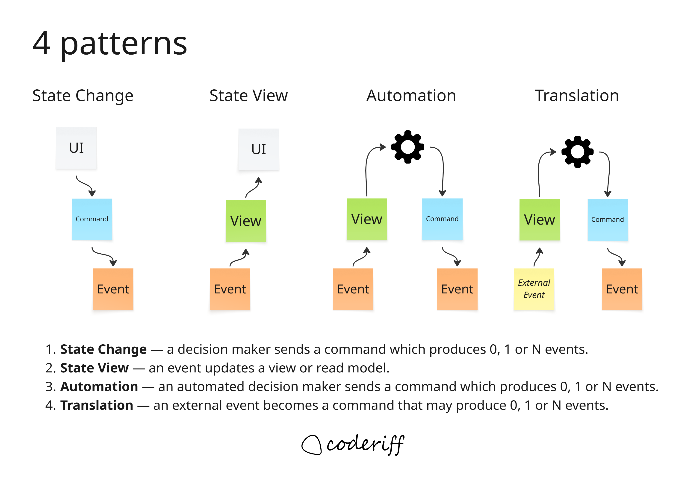

Building software requires agreement about how a system should behave. A requirement such as "ship the order when all products have arrived" sounds straightforward, but leaves questions unanswered. Which products are expected? How are arrivals associated with an order? What information tells us the order is ready? What happens if the products arrive in a different sequence?

Event Modeling makes those questions visible. It provides a shared blueprint of how information enters a system, changes over time, and supports the decisions that follow. Business experts, designers, developers, and testers can use that blueprint to discuss the same behavior before implementation begins.

## What is Event Modeling?

Event Modeling describes an information system through concrete examples of information changing over time. Developed by Adam Dymitruk, it connects events on a timeline with the actions that produce them and the information needed by people and automated processes. His [original introduction](https://eventmodeling.org/posts/what-is-event-modeling/) explains the approach in detail.

An event model follows a story through the system. It shows what a person sees, what they ask the system to do, what happens as a result, and how the resulting information becomes available for the next decision. Screens and processors sit alongside commands, events, and views to make that flow explicit.

Consider the warehouse fulfillment part of an eCommerce business. An order requires several products. Those products arrive at the warehouse separately, and the order must wait until all required products are available before it can be shipped. The model describes how the warehouse learns what to expect, records arrivals, and determines when to issue `Ship Order`.

You can apply Event Modeling to an event-sourced system or one that stores current state in a conventional database. Modeling a business event does not require publishing a message or persisting that event in an event store. The [guide to Event Modeling with traditional systems](https://eventmodeling.org/posts/event-modeling-traditional-systems/) explores this distinction.

## Why make the information flow explicit?

Requirements often describe an action without explaining where the information needed to perform it comes from. "Ship when everything has arrived" assumes that the system knows both what "everything" includes and what "arrived" means for this particular order.

Drawing that information flow exposes missing pieces. If a view shows the products still outstanding, we must explain where the expected product list originated and how each arrival updates it. If a processor sends `Ship Order`, we must explain which state makes that decision appropriate.

This creates a practical basis for collaboration. A warehouse expert can question a rule, a designer can identify missing information on a screen, and a tester can describe an exception using the same model. Concrete examples make disagreements easier to resolve than broad statements such as "the system handles fulfillment."

## The five elements

The following five elements describe the information and decisions involved in a workflow:

**UI** gives a person information and a way to act. A warehouse receiving screen might show an expected delivery and let an operator record a product arrival. A rough wireframe is enough to establish what the person needs to see and do.

**Command** expresses an intention to change the system. `Record Product Arrival` and `Ship Order` are requests that can be accepted or rejected according to business rules.

**Event** describes something that happened. `Product Arrived` and `Order Shipped` are facts expressed in the past tense. The distinction matters: requesting shipment does not mean the order has shipped.

**View**, also called a read model, represents information used to support a decision. An `Orders Awaiting Products` view could show the required products and the quantities still missing for each order.

**Processor automation** uses that information to decide when to send a command. It can observe that an order has all its required products and issue `Ship Order`. The command handler remains responsible for enforcing the rules governing that operation.

Together, these elements distinguish what someone intends, what happened, what is known, and what action should follow.

## The four patterns

These elements combine into four recurring patterns. The diagram below shows their information flow; the [Event Modeling cheat sheet](https://eventmodeling.org/posts/event-modeling-cheatsheet/) provides another reference.

### State change

A person or processor sends a command. Handling it may produce zero, one, or several events.

For example, a warehouse operator submits `Record Product Arrival`. If the arrival is valid, the system records `Product Arrived`, including the product identity, quantity, and the information needed to associate it with the expected fulfillment work.

### State view

Events supply information to a view. `Order Fulfillment Requested` establishes the products and quantities required for an order. `Product Arrived` contributes information about what has become available.

The resulting view lets someone answer: "Which products are still missing for this order?"

### Automation

A processor observes a view and sends a command when the relevant conditions are met. When an order has all its required products and shipment is still pending, the processor issues `Ship Order`.

### Translation

Translation brings information from another system or context into our domain's language. A supplier's delivery notification might lead to a `Record Product Arrival` command, which, if accepted, produces `Product Arrived` in the warehouse's model. This translation acts as an **Anti-Corruption Layer (ACL)**, protecting our model from the supplier's terminology and representation.

Sometimes, however, we only need external information to support a decision or validation. We might maintain a local view of a supplier's product catalog, for example. Updating that view is also projection: it keeps a local representation of information owned elsewhere, without necessarily initiating a business operation in our domain. The supplier remains the source of truth. Reading from it directly or maintaining an eventually consistent cache is an implementation choice, although the acceptable freshness of that information must be part of the decision rules.

The [Event Modeling HCL patterns guide](https://event-modeling-hcl.github.io/learn/patterns.html) explores these four patterns further.

## A view is conceptual

**A view describes information needed for a decision. Its green sticky note does not prescribe a storage mechanism.**

It could be implemented as a database table, a query result, a physical file, an object, or even a variable in memory. It might be persisted or calculated when needed. The implementation must meet the system's operational needs, but the model first establishes what the information means.

For `Orders Awaiting Products`, that means identifying the order, its expected products and quantities, what has arrived for it, and whether shipment remains outstanding. We can discuss those requirements before choosing where the information lives.

Views also serve automated processes. Information does not need to appear on a screen to deserve an explicit place in the model.

## Automation makes decisions from state

A common question is whether automation must be triggered by a view or can react directly to an event.

The useful distinction is between **what wakes the processor** and **what justifies its decision**. An event subscription, a scheduled job, or a change notification might prompt the processor to run. That mechanism is an implementation detail. In the event model, we want to describe the information that makes an action appropriate.

One way I find helpful to explain this is to imagine hiring someone to watch a UI and press a button when the information calls for it. We tell them: "Here are the products this order requires, and here is what has arrived. When everything is available, press Ship Order."

An automation performs that role without requiring an actual screen. Like a person using a UI, it acts on the state it can observe. An HTTP response may update a screen, but the person makes a decision from the information shown. Similarly, an event may wake a processor, while the view explains why it should act.

Sometimes one event supplies all the information needed, and a direct event handler is a reasonable implementation. Other decisions depend on information accumulated from several events. **The automation pattern makes that decision state explicit, independently of how the processor is triggered.**

## The TODO list pattern: waiting for products to arrive

Suppose order `W-1042` needs one keyboard, one mouse, and one monitor. For this example, each arrival is associated with this order, and received products are allocated to it. We assume payment, packing, and other shipment prerequisites are already satisfied so we can focus on the arrival condition.

The products can arrive in any sequence. A monitor arriving first should not cause shipment, and neither should receiving two notifications about the same keyboard. Readiness depends on the expected products and quantities being available for this order.

A view makes that distinction visible:

| Information received                            | Products still outstanding | Decision                 |
| ----------------------------------------------- | -------------------------- | ------------------------ |
| Fulfillment requested: keyboard, mouse, monitor | Keyboard, mouse, monitor   | Wait                     |
| Monitor arrived                                 | Keyboard, mouse            | Wait                     |
| Keyboard arrived                                | Mouse                      | Wait                     |
| Mouse arrived                                   | None; shipment pending     | Send `Ship Order`        |
| Order shipped                                   | None; shipment complete    | No shipment work remains |

Keyboard, mouse, monitor would lead to the same readiness state as monitor, keyboard, mouse. The decision depends on what has arrived, not on which product happened to arrive last.

This fits the **processor–TODO list pattern**. A view represents outstanding work, a processor issues commands for eligible work, and the resulting events update the view to mark that work as done. Martin Major explores another example in [Learning Event Modeling: Processor-TODO-List pattern](https://www.linkedin.com/pulse/learning-event-modeling-processor-todo-list-pattern-martin-major-8b26c/).

Our TODO list contains orders awaiting shipment. Each entry tracks its expected products and the arrivals allocated to it. An order becomes eligible for `Ship Order` when none of its required quantities are missing. `Order Shipped` then removes that order from the outstanding shipment work.

The flow is:

1. `Order Fulfillment Requested` establishes the order's expected products and quantities.
2. `Product Arrived` facts update the view as products arrive, in any sequence.
3. The processor observes that every required product is available and shipment is pending, then sends `Ship Order`.
4. The command handler validates the request and, when shipment succeeds, records `Order Shipped`.
5. The view marks the shipment task as complete.

Issuing the command alone does not check off the task: the outcome establishes that the work is done. If shipment involves further physical steps or an external carrier, those steps and their outcomes can be modeled explicitly too.

Drawing only `Product Arrived → Processor → Ship Order` would hide the expected product list and the accumulated arrivals. The view explains why one arrival leads to waiting while another makes the order ready.

This also gives operations useful information: which orders are waiting, which products are missing, and which ready orders have not yet shipped. A person and a processor can use the same conceptual view.

The model still leaves implementation work to do. Duplicate arrival notifications must not increase available quantities twice, products must not be allocated to multiple orders, and concurrent processors must not cause duplicate shipments. Cancellations, damaged products, partial deliveries, and partial shipment policies deserve their own scenarios. The model helps identify these questions and express the agreed behavior.

## From an event model to vertical slices

Event Modeling fits naturally with **vertical slice development**. A vertical slice delivers a specific behavior through the parts of the system needed to make it work: its entry point, rules, storage interactions, and observable result.

The warehouse model suggests cohesive pieces of work: recording a product arrival, showing outstanding products, or shipping an eligible order. Each can be specified with its inputs, expected outcomes, and relevant examples. The [cheat sheet's discussion of slicing](https://eventmodeling.org/posts/event-modeling-cheatsheet/#slicing) connects the modeled patterns to implementation slices.

For `Ship Order`, the team can agree on the required information, the conditions under which shipment is allowed, and the resulting events. For the arrival view, it can describe how different arrival sequences produce the same final state.

A slice may include several collaborating components, and slices can share infrastructure. The point is to organize delivery around a behavior that can be reviewed and verified end to end. The event model supplies the surrounding context and makes dependencies on other behavior visible.

## Using the model with AI-generated code

A sufficiently detailed event model can also provide a useful specification for AI-generated code. It supplies domain language, command and event data, decision rules, and concrete examples against which an implementation can be checked.

For the warehouse workflow, those examples might include:

- Given an order waiting for a mouse, receiving only its keyboard must leave shipment pending.
- Given all expected products allocated to an unshipped order, the processor should issue `Ship Order`.
- Given the same valid arrivals in a different sequence, readiness should be the same.
- Given a duplicate arrival notification, the received quantity must remain unchanged.
- Given an already shipped order, no shipment task should remain.

The model becomes more useful when paired with a **development harness**: an environment in which the AI can inspect the relevant code, run the application and checks, execute acceptance scenarios, and use the results to correct its implementation. **Skills** can supply reusable instructions for implementing slices, respecting architectural boundaries, following repository conventions, and validating the result.

That combination gives the AI a defined behavior to implement, a repeatable way to work, and feedback about whether its output matches the specification. It also gives reviewers a way to assess the generated code against agreed business examples.

A diagram with names alone will leave substantial gaps. The team still needs to specify rules, data, exceptions, and operational constraints. The value comes from making those decisions explicit enough that both people and tools can work from them.

## Why I use it

What I particularly appreciate about Event Modeling is how it connects a business conversation to implementation. The same model helps explain why a warehouse order must wait, identify the information needed to release it, and define a slice that delivers that behavior.

It gives the team something concrete to question and improve together. Once that shared understanding exists, choosing implementation mechanisms—and using AI to help build them—becomes a much more focused task.
