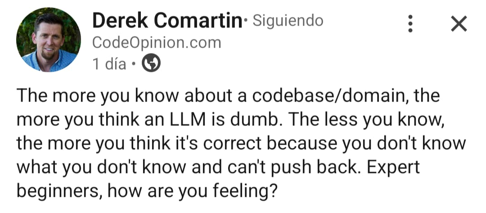

> Nota: He considerado que este artículo también merece la pena en español. [Leer la versión original en inglés](/blog/ai-is-not-your-senior-engineer)

Los LLM son buenos en muchas cosas. Se les da especialmente bien hacer que una conjetura parezca una respuesta.

Dales una petición plausible y producirán código, pruebas, documentación, una explicación segura de sí misma y, a veces, hasta una pequeña celebración. Esa fluidez es útil. También es peligrosa. **Un LLM puede hacerte sentir que entiendes un sistema antes de que hayas descubierto qué es realmente ese sistema.**

He empezado a pensar en ellos como _fábricas de Dunning-Kruger_: máquinas capaces de fabricar la sensación de competencia a escala industrial. Lo digo como provocación, no como diagnóstico psicológico de un modelo de lenguaje. La idea práctica es más sencilla: cuanto menos sabes de un dominio, más difícil es detectar lo que el modelo ha pasado por alto y más convincente puede parecer su respuesta.

El verdadero peligro no es que la máquina escriba una función evidentemente absurda. Es que escriba una función plausible, para una interpretación plausible del problema, dentro de un sistema cuyas restricciones más importantes nunca se mencionaron.

## Hemos confundido código más barato con software más barato

Ya dependemos de sistemas difíciles de entender y sorprendentemente fáciles de interrumpir. El 16 de noviembre, clientes de Chase y otros bancos informaron de problemas con sus transacciones después de que Chase sufriera un incidente técnico. Según informó [The New York Times](https://www.nytimes.com/2026/11/16/us/bank-outages-down.html), el problema de Chase también podía afectar a clientes de otras entidades cuando Chase participaba en una transacción.

No estoy sugiriendo que la IA causara esa interrupción. Es un recordatorio del mundo en el que ya existe el software: un fallo en una parte puede propagarse por las conexiones y convertirse en el problema de otra persona. El sistema moderno rara vez es una aplicación con un único responsable. Es una red de servicios, proveedores, sistemas heredados, políticas, personas y supuestos. Cada año dependemos más de ella, a menudo sin ver cuánto depende de cuánto más.

Me preocupa que la IA no esté haciendo automáticamente que esos sistemas sean menos complejos o frágiles. En muchas organizaciones está haciendo lo contrario. Hace que una nueva funcionalidad, integración, automatización o herramienta interna "rápida" resulte lo bastante barata como para aprobarla. Pero el coste de producir código nunca fue el coste total de producir software.

**El código puede ser barato de crear y caro de mantener.**

La primera versión suele ser la parte fácil. Una demo convincente puede aparecer en una tarde. Un flujo puede parecer lo bastante real como para crear expectativas, atraer usuarios y generar una hoja de ruta. Después llega el mundo real: permisos, excepciones, migraciones, auditorías, calidad de datos, soporte, interrupciones, usuarios que no siguen el camino feliz y equipos que discrepan sobre lo que debía significar la funcionalidad.

Un prototipo puede dar la impresión de que el trabajo difícil ya terminó. En producción, suele ser cuando empieza.

## El principiante experto tiene una nueva herramienta de productividad

La IA ha reducido la distancia entre "tengo una idea" y "tengo algo que parece software". Eso es una mejora real. Permite que más personas exploren una idea y la comuniquen de forma concreta. Un experto de negocio que ahora puede crear un prototipo aproximado quizá ayude al equipo a visualizar un flujo de trabajo que antes era difícil explicar en una reunión.

Pero un prototipo no demuestra que hayamos entendido el problema. Es una hipótesis con interfaz de usuario.

Algunos expertos recién empoderados, a quienes podemos llamar _estrategas visionarios de plataformas_ cuando ya han reservado la sala de reuniones, han dado el siguiente paso: quizá podamos prescindir de esos ingenieros incómodos, con sus sueldos elevados y sus preguntas inoportunas. Seguro que el modelo puede convertir los requisitos en software de producción. ¿Tan difícil puede ser?

La pregunta suele aparecer antes de que alguien tenga que operar el resultado.

Un LLM puede ayudar a implementar una idea. No puede completar una idea incompleta por el mero hecho de hacer que compile. No puede inferir qué política de negocio es la válida cuando tres departamentos discrepan. No sabe que una excepción es obligatoria por ley, que una integración antigua conlleva un compromiso no documentado o que un equipo usa la palabra "cliente" con tres significados distintos.

Puede generar una respuesta a la pregunta que le hemos hecho. **No puede rescatarnos de las preguntas que todavía no sabemos hacer.**

La captura de abajo recoge una observación de [Derek Comartin](https://codeopinion.com/): cuanto más sabes de una base de código o de un dominio, más fácilmente detectas dónde se equivoca un LLM. Coincide con mi experiencia. La pericia no vuelve menos capaz al modelo. Hace más visibles sus omisiones.

Por eso desconfío cuando "funciona" significa "la demo se ejecutó una vez". Que algo se ejecute no significa que sea correcto. Que pase una batería de pruebas no significa que satisfaga al negocio. Y que una respuesta suene experta no demuestra que nadie haya comprobado sus supuestos.

## Más producción desplaza el cuello de botella

La carrera por adoptar IA no ocurre en el vacío. Hay FOMO, entusiasmo genuino, presión para mostrar rentabilidad a los inversores y un mercado lleno de herramientas cuyos precios subvencionados y capacidades cambian cada pocos meses. Ante todo ese ruido, algunas empresas están haciendo grandes apuestas por la IA y, al mismo tiempo, recortando a las personas que saben cómo funcionan sus sistemas.

Eso puede dar sensación de aceleración. Más commits, más pull requests, más funcionalidades en curso. Pero el rendimiento de una fase no equivale al rendimiento del sistema completo. Si producir código se acelera mientras la comprensión, la integración, las pruebas y la revisión siguen igual, la cola simplemente se desplaza.

Un [artículo de investigación en curso de Fiona Chen y James Stratton](https://fion.ac/jellyfish.pdf), _Artificial Intelligence in the Firm: Bottlenecks in Software Production_, analiza 445 millones de eventos de trabajo en 655 empresas. Los autores informan que la adopción de IA aumenta sustancialmente la producción de código, con un efecto menor en el software completado, y encuentran que la revisión de código se convierte en un cuello de botella. En su muestra no detectan un efecto en el empleo durante el periodo estudiado. No es una conclusión universal sobre todos los equipos o herramientas, y el documento sigue siendo un artículo de investigación en curso. Aun así, cuestiona de forma útil la ecuación simplista de más código generado igual a más software entregado.

La pregunta importante no es "¿cuántas líneas escribió el modelo?". Es "¿cuánto cambio útil y verificado llegó a los usuarios, y cuánto nos costó conseguirlo?".

Si la revisión ya es un cuello de botella, generar más código no lo elimina. Puede hacer la pila más alta. Si pedimos a los revisores que aprueben cambios que no han ayudado a diseñar, en partes del sistema que ya no entienden, el problema no es solo la cantidad de líneas. Es la capacidad cada vez menor de saber si esas líneas deberían estar ahí.

Una respuesta tentadora es automatizar también la revisión y dejar que unos agentes aprueben el trabajo de otros. Eso puede ayudar con algunas comprobaciones mecánicas. Pero una máquina no puede validar una política que nunca se expresó ni reconocer un compromiso organizativo oculto, a menos que le demos contexto suficiente y sepamos qué contexto importa. Automatizar la apariencia de una revisión no equivale a responsabilizarse del cambio.

**El cuello de botella no es una molestia que debamos eliminar. Es información sobre dónde está el trabajo difícil.**

## La parte difícil nunca fue teclear

La ingeniería de software siempre ha sido mucho más que traducir una especificación a código. Las especificaciones suelen ser parciales, contradictorias o equivocadas de formas que nadie ha descubierto aún. El trabajo consiste en averiguar qué necesitan realmente las personas, qué promete ya el sistema, qué restricciones importan y dónde chocará el cambio propuesto con algo más.

Por eso los ingenieros se parecen más a detectives que a empleados que se limitan a registrar requisitos. Buscamos evidencias en el código, los datos, los casos de soporte, las conversaciones, el comportamiento operativo y los espacios entre equipos. A veces alguien no sabe lo que necesita hasta que escucha otra restricción y cambia de opinión a mitad de una conversación. Eso no es un fracaso de la captura de requisitos. Es descubrimiento.

La Ley de Conway describe una razón por la que estos problemas son tan persistentes: los sistemas tienden a reflejar las estructuras de comunicación de las organizaciones que los construyen. Si el conocimiento está repartido entre equipos, los incentivos chocan y las personas que entienden un flujo no pueden hablar con quienes lo desarrollan, ningún asistente de programación disolverá esas fronteras. Las [implicaciones de la ley](https://martinfowler.com/bliki/ConwaysLaw.html) son arquitectónicas porque, antes que nada, son humanas.

La IA trabaja con el contexto al que tiene acceso y con las preguntas que hacemos. **El contexto sigue siendo el rey.** Pero el contexto no es una colección mágica de documentos que copiamos en un prompt. Alguien tiene que descubrirlo, juzgar qué es relevante, resolver contradicciones y mantener una comprensión coherente mientras el sistema cambia. Esa persona necesita saber lo suficiente para detectar cuándo falta algo en la respuesta.

Cuanto mejor escriba código el modelo, más valioso será saber si ese código debería existir.

## Un proyecto nuevo es una demo seductora. Producción es donde llega la discusión

Empezar desde un repositorio vacío resulta seductor. El contexto es pequeño. No hay usuarios a los que decepcionar, migraciones incómodas, datos que acumulan quince años de casos límite, otro equipo que depende de un comportamiento que todo el mundo olvidó documentar. Un prompt, unas iteraciones y el resultado puede parecer sorprendentemente completo.

Después llegan los usuarios. El sistema acumula estado. La gente crea soluciones provisionales. Otro servicio empieza a depender de su comportamiento. Cambia una regla de negocio. Una excepción "temporal" se convierte en un compromiso. Los autores originales se marchan. Lo que parecía una aplicación pequeña pasa a formar parte de una máquina mayor.

**La demo demuestra que el software puede iniciarse rápido. Producción demuestra si puede cambiarse con seguridad.**

Por eso la capacidad de eliminar y sustituir código importa tanto como la capacidad de producirlo. En ["The Art of Destroying Software", Greg Young defiende diseñar el software para que sus partes puedan borrarse y reescribirse sin miedo](https://www.youtube.com/watch?v=1FPsJ-if2RU). La idea útil no es destruir por diversión. Es hacer que el cambio sea asumible: mantener límites claros, limitar el tamaño de los componentes y evitar que una decisión se vuelva permanente solo porque es cara de deshacer.

La IA aumenta la importancia de esa disciplina. Si generar es barato, produciremos más experimentos, más alternativas y más código que quizá luego resulte innecesario. Debemos optimizar no solo para escribir una funcionalidad, sino también para aprender que ya no hace falta y retirarla limpiamente.

Un sistema fácil de cambiar es valioso. Un sistema fácil de eliminar da aún más libertad.

## Agile debía servir para aprender mientras construimos

La debilidad de Waterfall no era que planificar o diseñar fueran inútiles. Era asumir que podíamos decidir demasiado al principio, justo cuando menos sabemos del proyecto, y luego avanzar por fases rígidas como si la realidad fuera a quedarse quieta por cortesía.

El [Manifiesto Ágil](https://agilemanifesto.org/) situó a las personas y sus interacciones, el software que funciona, la colaboración con el cliente y la respuesta al cambio por delante de los procesos, la documentación exhaustiva, la negociación contractual y el seguimiento de un plan. No decía "sáltate el análisis". Describía un ciclo de retroalimentación en el que aprendemos mediante la construcción, las pruebas, la conversación y la revisión.

Los rituales que después crecieron alrededor de Agile a veces perdieron de vista ese propósito. Un equipo puede celebrar todas las ceremonias del calendario y seguir evitando aprender. Lo mismo puede pasar con la IA y el desarrollo basado en especificaciones: redactar al principio una especificación enorme y detallada, entregársela a un agente y llamar eficiente al proceso porque el código apareció deprisa.

Eso puede convertirse en Waterfall con una fase de tecleo más rápida. El coste oculto se desplaza a los supuestos iniciales y a la revisión posterior.

Una especificación es útil cuando registra lo que hemos aprendido y nos ofrece algo concreto que cuestionar. Es peligrosa cuando la tratamos como un mapa completo de un dominio que aún no hemos explorado. Deberíamos usar la IA para acortar los ciclos de retroalimentación, no para poner en producción antes nuestra primera conjetura.

## El conocimiento que dejamos de practicar se volverá escaso

Delegar cada vez más el pensamiento tiene otro riesgo. El camino importa, no solo el resultado final. Cuando los ingenieros trabajan un problema, leen código desconocido, siguen el rastro de un fallo, discuten un modelo o ponen a prueba una hipótesis, construyen el mapa mental que les permite detectar cuándo el próximo cambio está mal.

Si cedemos cada paso difícil, quizá sigamos obteniendo respuestas. También podemos perder a las personas capaces de evaluarlas. La verificación no es un botón que aparece automáticamente cuando generar se vuelve rápido. Es una habilidad que se construye con fundamentos, experiencia y contacto con el sistema.

Lo mismo ocurre con el conocimiento del que se nutren los modelos. Los sistemas actuales parten de un enorme corpus de material creado por personas. Todavía no sabemos cómo evolucionarán la disponibilidad y la calidad de ese material a medida que se genere más texto y código con modelos, ni cómo tratarán los sistemas futuros el conocimiento raro, local, mal documentado o alejado de los patrones dominantes de sus datos de entrenamiento. Pero la novedad y los casos límite son precisamente los lugares donde "la respuesta estadísticamente más familiar" puede ser menos útil.

No predigo que la IA se vaya a quedar sin ideas el año que viene. Es una razón para preservar la experiencia humana, las fuentes primarias y el hábito de pensar desde los fundamentos, en lugar de tratar por defecto la continuación más probable del modelo como si fuera la respuesta.

## No temo a la herramienta. Desconfío del relato

No soy pesimista sobre la posibilidad de que la IA sustituya a los ingenieros. Uso estas herramientas y valoro lo que pueden hacer. Son amplificadores: pueden ayudar a un ingeniero reflexivo a explorar, explicar, prototipar e implementar con más eficacia. También pueden ayudar a una organización a escalar su confusión, publicar supuestos más deprisa y crear una cola de revisión más grande.

La herramienta no decide qué dirección amplificar. Nosotros sí.

A corto plazo, es comprensible que las empresas recorten costes, compren herramientas, anuncien transformaciones e intenten demostrar rentabilidad. Habrá mejoras reales. También habrá experimentos caros, productos descartados y promesas que no sobrevivan al contacto con producción. Si la inversión se enfría o una burbuja se desinfla, eso no significará que la tecnología desaparezca. Significará que el mercado tendrá que distinguir el valor duradero de una demo especialmente elaborada.

Los escépticos en quienes confío no son quienes se niegan a probar la IA. Son quienes la usan, conocen sus fortalezas y aun así preguntan qué ha hecho más difícil de ver el nuevo proceso. Calificar cada pregunta de miedo a ser reemplazado es una forma cómoda de evitar responderla.

Necesitamos ingenieros que combinen criterio técnico y conocimiento del dominio; que compartan lo que saben entre equipos; que formulen preguntas capaces de revelar la regla que falta; que distingan el código que funciona del software que cumple un propósito; y que entiendan que decidir no construir algo también es una decisión de ingeniería.

Esas personas no serán menos importantes a medida que resulte más fácil producir código. **Serán más difíciles de encontrar y más valiosas.**

Así que sí: usa el modelo. Deja que redacte, explore, explique y te sorprenda. Después lee el resultado. Cuestiona sus supuestos. Dale el contexto que no puede descubrir por sí solo. Y cuando se dirija con confianza en la dirección equivocada, atrévete a decir lo más sencillo y útil que puede decir un ingeniero:

**Sí, te equivocas.**
